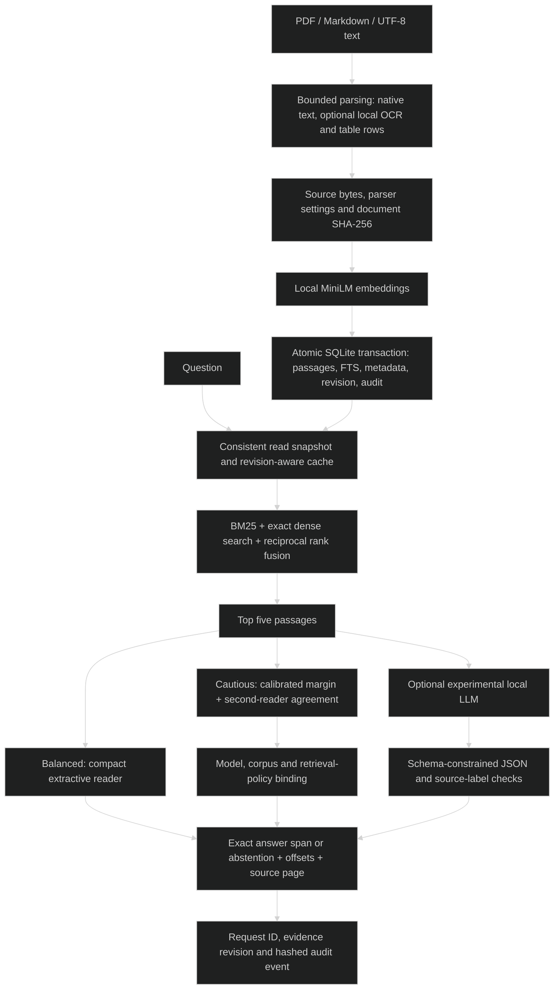

# AEGIS — Offline RAG

> `CPU-capable local document retrieval with extractive answers and traceable evidence.`

### 🏗️ System Architecture



### 🛠️ Production Stack

Python 3.12 · Streamlit · PyMuPDF · sentence-transformers · PyTorch CPU · BM25 · SQLite · optional Ollama

### ⚡ Key Engineering Capabilities

- Hybrid sparse/dense search combines complementary retrieval signals.
- Transactional replacement preserves the previous document if ingestion fails.
- Reader spans, audit records and backup commands expose evidence and index state.

### 🚀 Deployment and Local Setup

Run from the repository root after cloning:

```bash
git clone https://github.com/ryash14/aegis-offline-rag.git
cd aegis-offline-rag
uv venv --python 3.12 .venv
uv pip install --python .venv/bin/python -r requirements.lock.txt --extra-index-url https://download.pytorch.org/whl/cpu
uv pip install --python .venv/bin/python -e '.[ui,dev]'
mkdir -p data models reports
curl -4 -fL https://public.ukp.informatik.tu-darmstadt.de/thakur/BEIR/datasets/scifact.zip -o data/scifact.zip
.venv/bin/python scripts/prepare.py
.venv/bin/python scripts/stage_reader.py
.venv/bin/python -m aegis.cli --db data/documents.sqlite ingest /absolute/path/to/documents
./scripts/run-local.sh
```

Install Tesseract for OCR. Setup downloads model weights and public evaluation data; runtime uses staged local assets. Open http://127.0.0.1:8501. Optional second-reader agreement requires separately staged weights and corpus-bound policies. Supported deployment is one trusted local user. Experimental Ollama generation is optional.

### Verification

```bash
make test
make check
```

These commands are provided by the source configuration; this documentation update does not claim a fresh end-to-end application run.

### Source Map

- [docs/ARCHITECTURE.md](docs/ARCHITECTURE.md)
- [docs/DEPLOYMENT.md](docs/DEPLOYMENT.md)
- [models.lock.json](models.lock.json)
