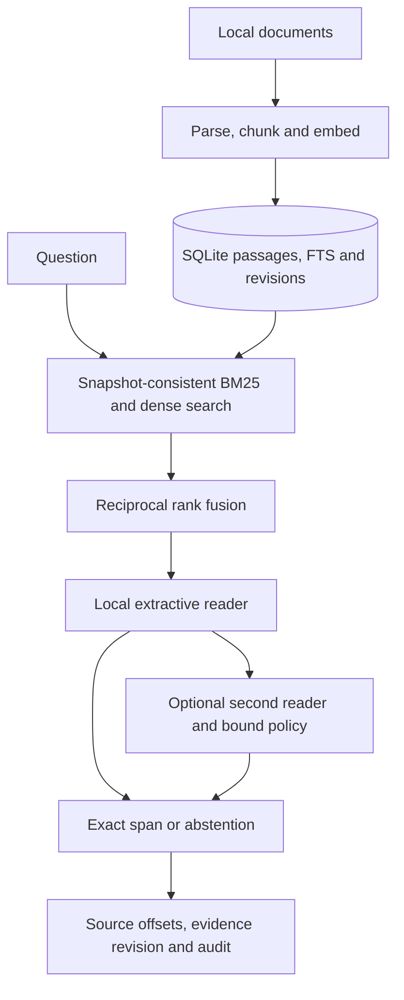

# AEGIS — Offline RAG

AEGIS Offline RAG searches local documents and returns extractive answers with source pages and character offsets.

For private document work, retrieval quality and inspectable evidence matter as much as fluent generation. This implementation uses lexical and dense retrieval with a compact local reader. It can return an exact passage span or abstain, without requiring an external inference API after assets have been staged.

[](https://github.com/ryash14/aegis-offline-rag/actions/workflows/ci.yml)

[Quick start](#quick-start) · [How it works](#how-it-works) · [Development](#development) · [Contributing](CONTRIBUTING.md)

## Quick start

Use Python 3.12 and uv. Install Tesseract for OCR. Setup requires network access for models and the supplied evaluation dataset; inference operates on staged local files. Policies calibrated on one corpus do not automatically transfer to another.

From a fresh checkout:

```bash
git clone https://github.com/ryash14/aegis-offline-rag.git
cd aegis-offline-rag
uv venv --python 3.12 .venv
uv pip install --python .venv/bin/python -r requirements.lock.txt --extra-index-url https://download.pytorch.org/whl/cpu
uv pip install --python .venv/bin/python -e '.[ui,dev]'
mkdir -p data models reports
curl -4 -fL https://public.ukp.informatik.tu-darmstadt.de/thakur/BEIR/datasets/scifact.zip -o data/scifact.zip
.venv/bin/python scripts/prepare.py
.venv/bin/python scripts/stage_reader.py
.venv/bin/python -m aegis.cli --db data/documents.sqlite ingest /absolute/path/to/documents
./scripts/run-local.sh
```

Install Tesseract for OCR. Setup downloads model weights and public evaluation data; runtime uses staged local assets. Open http://127.0.0.1:8501. Optional second-reader agreement requires separately staged weights and corpus-bound policies. Supported deployment is one trusted local user. Experimental Ollama generation is optional.

## CLI workflow

Once the index and reader assets are staged:

```bash
.venv/bin/python -m aegis.cli --db data/documents.sqlite search 'When must the valve be inspected?' --reader
.venv/bin/python -m aegis.cli --db data/documents.sqlite doctor
.venv/bin/python -m aegis.cli --db data/documents.sqlite audit
.venv/bin/python -m aegis.cli --db data/documents.sqlite backup data/backups/documents.sqlite
```

The question is an example: the result depends on your indexed documents. A useful outcome may be an abstention when the evidence does not contain the answer. Backups preserve the index; they do not securely erase deleted source content from other copies.

## How it works

1. Stage the pinned encoder and reader models, then ingest a document directory.
2. Search through Streamlit or the CLI. Retrieval combines BM25 with exact dense search.
3. Inspect the answer span, page, passage identity and evidence revision.
4. Use the doctor, audit and backup commands to inspect and preserve the local index.

### Component boundaries



### Design decisions

SQLite holds passages, full-text search metadata, index revisions and audit records. Dense retrieval uses local embeddings; reciprocal rank fusion combines ranks rather than adding incomparable similarity scores. Transactional replacement preserves the previous document if a new ingestion fails.

Balanced mode uses a compact extractive reader. Cautious mode adds a separately staged reader and a policy bound to model, corpus and retrieval settings. Agreement and exact-span checks improve inspectability; they do not prove that an answer is correct. Optional Ollama generation is experimental.

## Implementation

**Stack:** Python 3.12 · Streamlit · PyMuPDF · sentence-transformers · PyTorch CPU · BM25 · SQLite · optional Ollama.

- [docs/ARCHITECTURE.md](docs/ARCHITECTURE.md)
- [docs/DEPLOYMENT.md](docs/DEPLOYMENT.md)
- [models.lock.json](models.lock.json)

## Development

The hosted ingestion suite currently stops during collection because `tests/test_ingestion.py` imports `scripts.build_fixtures`, which is absent from the repository. The commands below describe the development workflow, but the published CI result is not a passing test guarantee until that fixture builder is restored or the test setup is corrected.

Run the repository checks after completing setup:

```bash
make test
make check
```

Use the offline checks during development. Run provider-backed integration checks separately with configured credentials and representative inputs.

## Contributing and support

Report reproducible bugs or propose changes through [GitHub Issues](https://github.com/ryash14/aegis-offline-rag/issues). Include the relevant environment and a small example rather than private datasets or credentials. See [contributing](CONTRIBUTING.md), [security reporting](SECURITY.md) and the [code of conduct](CODE_OF_CONDUCT.md).

## License

No repository-wide license is currently provided. Third-party components, models and datasets retain their own terms.
