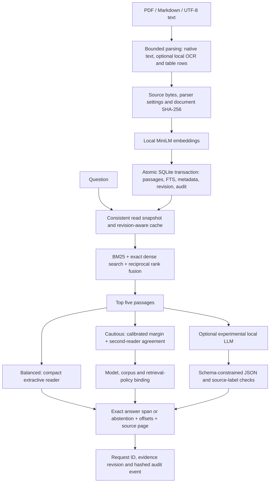

# Architecture and trust boundaries · v0.2

## Retrieval on small machines

SQLite FTS5 supplies BM25; normalized 384-dimensional float32 vectors support cosine similarity through a contiguous NumPy matrix product. At 7,179 passages, the vectors occupy approximately 10.5 MiB. This excludes model weights, libraries, extracted text, and interpreter memory. Exact search avoids approximate-neighbor tuning at this scale. ANN search becomes appropriate when measured corpus growth warrants its build time, approximation error, and memory costs.

RRF combines reciprocal ranks with constant 60, rather than adding incomparable BM25 and cosine scores. The historical SciFact evaluation retains BM25, dense, hybrid and reranking results. Reranking was slower and less accurate there, so it is optional. Four Torch threads and one OpenBLAS thread bound CPU concurrency in the measured launch configuration.

## Answering and abstention

Balanced mode uses `deepset/minilm-uncased-squad2` (approximately 33M parameters). It processes up to 384-token windows, 128-token stride, 64-token questions, and 30-token answer spans. Windows from multiple passages are batched together, with at most eight inference windows per batch. Input size and passage count are bounded. Every accepted answer is a checked substring with character offsets, document ID, page, passage ID and evidence revision. A correct substring can still be the wrong answer.

Cautious mode requires a calibrated primary-score margin and normalized answer agreement from `deepset/tinyroberta-squad2` on the selected source passage. The second reader must also prefer an answer over its CLS no-answer score. It runs only when the primary margin clears the threshold. Both readers were trained on the same task; agreement is not statistical independence or proof of truth.

Calibration uses 600 tuning questions, an independent 400-question validation group, and a 600-question final evaluation group. Groups have disjoint source paragraphs, and questions from the v1 experiments are excluded. Threshold selection reads only tuning labels. Validation can veto activation. The policy artifact is written before the held-out results are summarized. See the frozen split plan and scripts for exact selection criteria.

The validated policy is bound to the model fingerprints, retrieval mode, top-k, candidate count, chunking configuration, and corpus digest. Changing documents or switching profiles invalidates it. Calibration does not automatically transfer to private documents: that collection needs labeled evaluation and its own policy. Precision among accepted answers and coverage are reported together; a 95% selective precision figure does not mean 95% accuracy across all requests.

The optional Qwen 3B Q4 LLM remains experimental because its QA results were poor. JSON Schema constrains output structure; unknown labels are rejected, missing inline markers can be rendered from known structured labels, and explicit refusals are normalized to abstention. These checks do not establish entailment or injection resistance. No tools or code execution are available to the model. The daemon launcher bounds context, model count, queue length, and host prompt cache.

## Consistency and recovery

A write transaction uses `BEGIN IMMEDIATE` before reading/replacing existing FTS rows. Passages, document/source metadata, the monotonically increasing index revision, and mutation audit events commit together. Failed embedding or insertion preserves the prior document. A per-connection reentrant lock serializes operations sharing a SQLite connection; WAL supports other connections reading during a write.

Retrieval holds one SQLite read snapshot across lexical search, vector lookup and passage loading. Dense matrices carry their index revision and refresh after another connection commits an ingestion/deletion. Engine answers and bounded LRU caches are keyed by revision and policy hash. Query evidence remains associated with its original snapshot even if ingestion commits while the answer is being computed.

`doctor` checks SQLite health, missing/orphan/duplicate/stale FTS rows, and the audit chain. `backup` uses SQLite's online backup API and refuses to overwrite an existing target. Recovery, concurrent writers, external refresh and rollback are exercised in tests. New index and backup files use mode 0600. Logical deletion does not securely erase SQLite free pages, WAL, caches or backups.

## Parsing contracts

PDF, Markdown and UTF-8 text are supported. Files are limited to 50 MiB, PDFs to 500 pages, and OCR rendering to 25 million pixels per page. Low-text image pages require explicit local OCR rather than silent partial ingestion. OCR uses installed English Tesseract data and does not download at runtime. Table mode adds header/value associations and retains table bounding boxes. Encrypted or corrupt files are reported individually; previous indexed versions survive failed replacements.

Byte hashes and parser settings allow unchanged documents to skip parsing and embedding. Optional folder synchronization prunes only documents belonging to that root, and only after an error-free scan. It deletes indexed records, not source files. Synthetic regression fixtures cover native, scanned, table, corrupt and encrypted PDFs; they do not establish OCR accuracy on arbitrary real documents, handwriting or complex layouts.

Chunking remains sentence-aware overlapping word windows, not embedding-based semantic segmentation. The embedding tokenizer may truncate long windows. Every chunking change requires re-indexing and fresh measurement.

## Privacy and isolation

Staging downloads are separate from inference. Runtime uses local model paths, offline Hugging Face flags and fixed loopback Ollama HTTP with proxies disabled. Both readers, retrieval, policy enforcement, citations and audit are tested together inside a Linux namespace with no external routes. A Python socket guard additionally records attempted connects. The desktop launcher does not itself enforce host egress isolation.

Audit records contain hashes of questions/answers, source IDs, policy IDs, request IDs and evidence revisions, not raw query or answer text. Hashes of predictable inputs can still be guessed. Hash chaining detects edits relative to a trusted head checkpoint; an attacker who can replace the entire database and checkpoint can forge the chain. This is not a signed external audit service.

The deployment scope is one trusted local user. Multiuser authentication, document ACLs, encryption at rest and independent security certification are not implemented. A namespace test is evidence of a specific offline execution path, not proof of a certified defense deployment.
